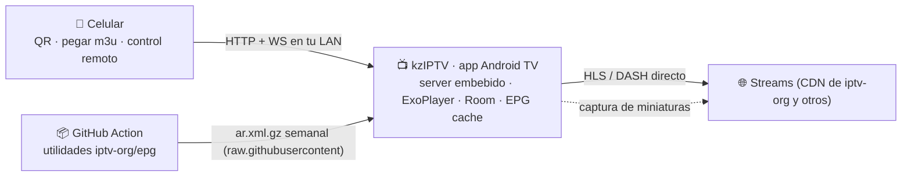

# kzIPTV — Diseño y plan (v1)

> IPTV player para **Android TV**: listas m3u (iptv-org y propias), setup por **QR desde el celular** sin escribir en la TV, zapping con las teclas **CH+ / CH−**, favoritos, guía **EPG** y comparación de canales (**mosaico + PiP**).

Estado: diseño cerrado con tus respuestas (24/10/2026) · próxima fase: **P0 (spike)**

## 1 · Objetivo y alcance

**Qué es kzIPTV**: app nativa de Android TV que reproduce listas m3u (HLS/DASH) con una UX pensada 100% para el control remoto, y que se configura desde el celular escaneando un QR — sin teclado en la TV, sin servidor externo.

Dentro de alcance (v1): zapping, favoritos, lista completa por categorías, búsqueda, EPG (ahora/siguiente + grilla), mosaico y PiP, celular como control remoto, múltiples playlists, ocultos/parental.

Fuera de alcance (v1): grabación/DVR, catch-up (la playlist de referencia no lo trae), sync entre TVs (P3), port a Samsung/LG (los parsers y el companion se reusan si algún día hace falta).

## 2 · Inventario verificado (research)

Playlist de referencia: https://iptv-org.github.io/iptv/countries/ar.m3u

| Métrica | Valor |
|---|---|
| Canales | **206** |
| HLS (.m3u8) | 199 (97%) — el primer stream probado es H.264/AAC 1080x608: decodificable por cualquier TV |
| DASH (.mpd) | 2 — ExoPlayer los reproduce nativos |
| mp4 progresivo | 1 |
| No reproducibles esperados | 1 (.flv) · 3 con extensión rara (.dev) a verificar en runtime |
| Logos (tvg-logo) | **100%** |
| IDs de EPG (tvg-id) | **100%** (ej. "A24.ar@SD") |
| Categorías (group-title) | 20: Undefined 63 · General 53 · Music 15 · News 13 · Entertainment 13 · Sports 12 · Movies 10 · Kids 10 · Animation 10 · Religious 9 · Culture 6 · Series 5 … |
| #EXTVLCOPT | 23 streams con headers propios (user-agent / referrer) que el player debe respetar |
| Catch-up | 0 en esta lista |
| EPG oficial de iptv-org | el XMLTV estático (index.xml) ya no existe (404); el repo **iptv-org/epg** está activo y trae las utilidades para generarlo |

**Teclas**: Android TV expone CH+ / CH− como KEYCODE_CHANNEL_UP/DOWN (**166/167**) a las apps — zapping nativo garantizado. (Dato guardado: en Samsung Tizen son 427/428, por si algún día portamos.)

**Tus decisiones**: solo Android TV · sin máquina siempre encendida → arquitectura **app-first con servidor embebido** · "comparar" = mosaico + PiP · EPG **esencial**.

## 3 · ¿Qué es posible? (viabilidad)

| Capacidad | Viabilidad | Cómo |
|---|---|---|
| Reproducir la lista | ✅ ~98% de entrada | Media3/ExoPlayer: HLS + DASH + mp4/ts progresivos; solo .flv queda fuera |
| Zapping con CH+ / CH− | ✅ | keycodes 166/167, funcionan en cualquier parte de la app |
| Setup por QR desde el celular | ✅ | servidor web embebido en la app (Ktor) + QR con código de un uso |
| Pegar el enlace sin teclado en la TV | ✅ | el QR abre la web en el celu → pegás/mandás → la TV recibe, parsea y confirma |
| Favoritos + zap solo entre favoritos | ✅ | long-press OK / tecla amarilla; modo zap con roja; Room local |
| Lista completa por categorías | ✅ | 20 grupos del m3u ("Undefined"→"Otros"), logos 100% |
| Búsqueda + número directo 0-9 | ✅ | teclado QWERTY D-pad + escribir desde el celu; buffer numérico |
| EPG ahora/siguiente + grilla | ✅ | XMLTV semanal generado con utilidades iptv-org/epg (GitHub Action gratis) |
| Mosaico de previews "en vivo" | ✅ | miniaturas capturadas en la propia TV (2.ª instancia ExoPlayer + ImageReader) |
| PiP en vivo | ✅* | 2.º decodificador real; *según SoC, con fallback a miniatura |
| Celular como control remoto | ✅ | misma conexión: D-pad virtual, teclado, lanzar canales |
| Favoritos iguales en varias TVs | ⚠️ P3 | sin server: export/import o sync por archivo/relay mínimo |
| Timeshift / catch-up | ⚠️ | playlist sin catchup; DVR local recién en P3 |
| Ocultar canales / parental | ✅ | PIN por canal o categoría |
| Streams con headers custom | ✅ | #EXTVLCOPT → per-request headers en ExoPlayer |

**La única limitación física real** es el decodificador: 1 principal + 1 secundario en la mayoría de los SoC de TV. Por eso el mosaico usa miniaturas refrescadas y el PiP es el único video simultáneo extra.

## 4 · Arquitectura



**Decisión clave**: como no hay servidor aparte, **la TV misma sirve la web de setup y control**. El server embebido solo escucha en tu LAN, solo corre con la app abierta (o si activás "control remoto siempre"), y exige código de emparejamiento + token por dispositivo.

### Flujo de setup (primera vez)
1. Abrís kzIPTV en la TV → pantalla de bienvenida con **QR grande** (http://IP-DE-LA-TV:8080/pair#CODIGO) + código de 6 dígitos.
2. Escaneás con el celu → se abre la web (servida por la propia TV) → pegás la(s) URL(s) m3u o subís un archivo.
3. "Enviar a la TV" → la app descarga, parsea (206 canales, 20 categorías, logos) y confirma: "Lista cargada ✓".
4. El emparejamiento queda guardado: el celu vuelve a entrar a la misma dirección y actúa de control remoto.

### Seguridad
- Código de un solo uso (expira al emparejar o en 10 min) · token por dispositivo · revocación desde Ajustes.
- HTTP en claro solo dentro de la LAN (networkSecurityConfig); sin puertos abiertos al exterior.
- QR regenerable · server apagable desde Ajustes.

## 5 · UX en la TV (remote-first)

**Principios**: 10-foot UI (tipografía ≥ 24sp, foco con glow + escala, alto contraste) · el D-pad es sagrado (todo con ↑↓←→ + OK + Back) · CH+ / CH− siempre cambian canal · percepción de velocidad (banner inmediato + precalentado de los manifest vecinos con OkHttp).

### Mapa de teclas (v1)

| Tecla | Corto | Largo |
|---|---|---|
| CH+ / CH− (166/167) | Siguiente/anterior canal (lista activa) | — |
| OK | Banner · 2ª vez: overlay de lista | ★ agregar/quitar favorito |
| Back | Cerrar overlay · en video: canal anterior | — |
| 0-9 | Número directo (auto-entrada a 2 s o con OK) | — |
| ↑↓←→ | Navegar | — |
| Roja (PROG_RED) | Modo zap: Todos ↔ Favoritos | Ajustes de lista |
| Verde | Ir a Favoritos | Reordenar (drag desde el celu) |
| Amarilla | ★ favorito | — |
| Azul | Guía EPG | Info técnica del stream |
| Play/Pause | (P3: timeshift) | — |
| Menú | Contextual: favorito, ocultar, ir al número, info | — |

(En remotos sin teclas de color, lo mismo vive en el overlay de OK / Menú.)

### Zapping y banner
- CH± al instante dentro de la lista activa; se reusa la misma instancia de ExoPlayer (switch ~0.8-2.5 s según CDN) y se pre-calientan los manifest de los vecinos (DNS + TLS + master).
- Banner 4 s: logo, nombre, número, ahora/siguiente (EPG), ★, badge de calidad.
- Back en video = canal anterior (zap clásico); segunda vez vuelve.

### Favoritos
- Long-press OK o tecla amarilla → ★ + toast. Modo "zap: Favoritos" con roja (el banner avisa el modo activo).
- Orden manual desde el celu (drag & drop) y automático "más vistos". Persistencia local (Room); sync entre TVs en P3.

### Listas y navegación
- Rail izquierdo: **Todos · Favoritos · Recientes · Categorías ▸ · Buscar**. Tarjetas: logo (placeholder generado si falla), nombre, número, badges (HD, offline, no soportado).
- Menú contextual (long-press / Menú): favorito, ocultar, ir al número, info del stream.
- Búsqueda: índice local (nombre + categoría) + teclado Compose TV + escribir desde el celu.
- Numeración: automática (alfabético / por categoría) o manual desde el celu.

### Comparar canales (ambos modos)
**Mosaico "Surf"** (P2): grilla 4×3 con miniaturas refrescadas cada 30-60 s **solo de la página visible**; la tarjeta enfocada se agranda con preview + ahora/siguiente; OK sintoniza. Implementación on-device: worker secuencial que reproduce cada canal muteado 1-2 s a 320×180 sobre un ImageReader (2.ª instancia de ExoPlayer), captura un frame y cierra; timeout de 6 s y máximo 1 job a la vez (plan B: binario ffmpeg estático si algún SoC da problemas).

**PiP** (P2): el canal actual queda en una esquina (video vivo, 2.º decodificador) mientras navegás listas/guía/mosaico; toggle desde el banner; fallback a miniatura refrescada si el SoC no maneja 2 decoders.

### Guía EPG (esencial)
- **Pipeline**: GitHub Action semanal (gratis, cron) que corre las utilidades del repo iptv-org/epg para los canales AR y commitea "epg/ar.xml.gz" al repo; la app lo descarga de raw.githubusercontent al iniciar y cada 24 h, con parser incremental y purge a 7 días. **P0: verificar match de tvg-id ("A24.ar@SD") ↔ ids del XMLTV; fallback por nombre normalizado.**
- **Banner**: ahora/siguiente en cada zap.
- **Grilla** (P2): filas = canales de la lista activa, timeline horizontal, línea de "ahora", OK sintoniza, panel de detalle con descripción, salto de fecha/hora.

### Ocultos / parental
- Ocultar canal o categoría con PIN de 4 dígitos; desaparecen de grillas y del zap.

## 6 · Companion (celular, servido por la TV)

Una sola web liviana (~50 KB) que vive dentro del APK y sirve el server embebido:
1. **Setup** (primera vez): pegar/subir m3u → "Enviar a la TV".
2. **Control remoto**: D-pad virtual, OK, Back, CH±, teclado para búsqueda, "lanzar canal" con tap en la grilla.
3. **Admin**: playlists (agregar/quitar/refresh), favoritos (drag & drop), numeración, ocultos, estado de canales (online/offline).
Sin login: alcanza el token de emparejamiento; todo lo vivo va por WebSocket contra la TV.

## 7 · Datos (Room)

- sources(id, nombre, url, tipo, lastRefresh, enabled)
- channels(id, sourceId, tvgId, nombre, logo, grupos, url, headersJson, numero, oculto, estado, lastCheck)
- favorites(channelId, orden) · recents(channelId, watchedAt)
- epg(tvgId, start, end, titulo, desc, categoria)
- devices(token, nombre, pairedAt)
- settings (DataStore): modo zap, duración banner, numeración, PIN, serverAlwaysOn

Refresh de playlist: cada 6 h (WorkManager) con diff por tvg-id → nombre que **preserva favoritos, ocultos y numeración**.

## 8 · Playback y casos borde

| Caso | Manejo |
|---|---|
| HLS (97%) | ExoPlayer directo, ABR activo |
| DASH (2 canales) | ExoPlayer directo |
| .flv (1 canal) | marcado "no soportado" (excluible); ffmpeg on-device solo si llega a molestar |
| #EXTVLCOPT (23 streams) | user-agent/referrer por canal → DefaultHttpDataSource con headers |
| Canal caído / geobloqueado | timeout + retry → estado offline en la tarjeta; opción "zap salta a siguiente online" |
| Aspecto | fit / fill / stretch (tecla azul o Ajustes) |
| Pistas | audio/subtítulos del stream cuando existen |

## 9 · Stack y estructura

- **app-tv/** (Kotlin): Jetpack Compose for TV (foco, lists, pivots) · Media3 ExoPlayer · Ktor embebido (o NanoHTTPD como alternativa mínima) · Room · DataStore · WorkManager · OkHttp · Coil (logos) · ZXing para el QR en pantalla. minSdk 22+.
- **companion/** (TypeScript): Vite + Preact; el build se empaqueta como assets del APK.
- **.github/workflows/epg.yml**: cron semanal + disparo manual; corre utilidades iptv-org/epg (Node) y publica epg/ar.xml.gz.
- Nota de stack: si venís de C#, Kotlin te va a resultar cómodo (corutinas ≈ async/await, Compose ≈ MAUI declarativo). Flutter es alternativa válida, pero Compose for TV maneja mejor foco y restauración de foco para D-pad.

```
kzIPTV/
  app-tv/                     # app Android TV (Kotlin + Compose for TV)
  companion/                  # web del celular (Vite + Preact) → assets del APK
  .github/workflows/epg.yml   # pipeline EPG semanal
  docs/PLAN.md                # este documento
```

## 10 · Roadmap

| Fase | Duración | Entregable | Criterio de salida |
|---|---|---|---|
| **P0 · Spike** | 1 finde | APK mínimo: parse de ar.m3u embebida + grilla + ExoPlayer + zap CH±; corrida local de utilidades EPG | reproducción fluida en tus TVs · zap < 2.5 s · teclas OK · XMLTV AR generado y matchea |
| **P1 · MVP** | 2-3 sem | server embebido + QR + companion de setup, favoritos, categorías, búsqueda, 0-9, banner, refresh con diff, Room | setup desde el celu en < 1 min · zap y favoritos usables a diario |
| **P2 · Guía y comparación** | 2-3 sem | EPG ahora/siguiente + grilla, mosaico on-device, PiP, celu como control remoto, health check | grilla usable · mosaico sin lag perceptible · PiP en tus SoC (o fallback) |
| **P3 · Avanzado** | continuo | sync entre TVs, timeshift/DVR, parental, perfiles, relay off-LAN, PWA del companion | — |

## 11 · Riesgos y fricciones

- **Compose for TV en TVs modestas**: probar P0 en tus modelos exactos (SoC económico + Android 9 puede ir justo; fallback: Views/leanback clásico).
- **Pipeline EPG de terceros**: iptv-org/epg está activo hoy; si muere, alternativas XMLTV o scrape propio.
- **Mosaico**: CPU/ancho de banda acotados → solo página visible, calidad baja, 1 job a la vez.
- **Sync entre TVs sin server** (P3): export/import por archivo o relay mínimo de ~50 líneas.
- **Legal**: kzIPTV es un reproductor genérico; iptv-org indexa streams públicos. Playlists privadas bajo tu responsabilidad.
- **Distribución**: sideload personal sin fricción; Play Store solo si algún día lo querés público (requiere revisión leanback).

## 12 · Próximos pasos (checklist P0)

1. Proyecto Gradle "app-tv" (Compose for TV) con grilla leyendo ar.m3u embebida.
2. ExoPlayer reproduciendo; CH± zap con banner básico; probar en las TVs reales y medir el zap.
3. Correr local (Node) las utilidades iptv-org/epg para AR; verificar match de tvg-id; generar ar.xml de prueba.
4. Hello-world del server embebido (Ktor) + QR en pantalla, abierto desde el celu.

Con P0 en verde, arrancamos P1 con el esqueleto completo (app + companion + workflow).
