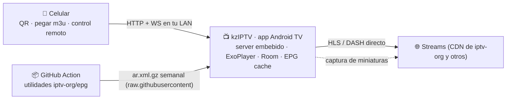

# kzIPTV — Diseño y plan (v1)

> IPTV player para **Android TV**: listas m3u (iptv-org y propias), setup por **QR desde el celular** sin escribir en la TV, zapping con las teclas **CH+ / CH−**, favoritos, guía **EPG** y comparación de canales (**mosaico de miniaturas**).

Estado: diseño cerrado (24/10/2026) · **P0 cerrado** (spike probado en la TV real) · **P1 en curso** · fase actual: **P1 (MVP)**

## 1 · Objetivo y alcance

**Qué es kzIPTV**: app nativa de Android TV que reproduce listas m3u (HLS/DASH) con una UX pensada 100% para el control remoto, y que se configura desde el celular escaneando un QR — sin teclado en la TV, sin servidor externo.

Dentro de alcance (v1): zapping, favoritos, lista completa por categorías, búsqueda, EPG (ahora/siguiente + grilla), mosaico de miniaturas, celular como control remoto, múltiples playlists, ocultos/parental.

> **Actualización (P1, medido en la TV):** el PiP del sistema **no existe en Android TV** y la TV
> tiene **un solo decoder de video por hardware**. La comparación se implementó como mosaico de
> miniaturas (un frame congelado por canal). Ver [P0-STATUS.md §10](P0-STATUS.md).

Fuera de alcance (v1): grabación/DVR, catch-up (la playlist de referencia no lo trae), sync entre TVs (P3), port a Samsung/LG (los parsers y el companion se reusan si algún día hace falta).

## 2 · Inventario verificado (research)

Playlist de referencia: https://iptv-org.github.io/iptv/countries/ar.m3u

| Métrica | Valor |
|---|---|
| Canales | **206** |
| HLS (.m3u8) | 199 (97%) — el primer stream probado es H.264/AAC 1080x608: decodificable por cualquier TV |
| DASH (.mpd) | 2 — ExoPlayer los reproduce nativos |
| mp4 progresivo | 1 |
| No reproducibles esperados | 1 (.flv) · 3 con extensión rara (.dev) a verificar en runtime |
| Logos (tvg-logo) | **100%** |
| IDs de EPG (tvg-id) | **100%** (ej. "A24.ar@SD") |
| Categorías (group-title) | 20: Undefined 63 · General 53 · Music 15 · News 13 · Entertainment 13 · Sports 12 · Movies 10 · Kids 10 · Animation 10 · Religious 9 · Culture 6 · Series 5 … |
| #EXTVLCOPT | 23 streams con headers propios (user-agent / referrer) que el player debe respetar |
| Catch-up | 0 en esta lista |
| EPG oficial de iptv-org | el XMLTV estático (index.xml) ya no existe (404); el repo **iptv-org/epg** está activo y trae las utilidades para generarlo |

**Teclas**: Android TV expone CH+ / CH− como KEYCODE_CHANNEL_UP/DOWN (**166/167**) a las apps — zapping nativo garantizado. (Dato guardado: en Samsung Tizen son 427/428, por si algún día portamos.)

**Tus decisiones**: solo Android TV · sin máquina siempre encendida → arquitectura **app-first con servidor embebido** · "comparar" = mosaico + PiP · EPG **esencial**.

## 3 · ¿Qué es posible? (viabilidad)

| Capacidad | Viabilidad | Cómo |
|---|---|---|
| Reproducir la lista | ✅ ~98% de entrada | Media3/ExoPlayer: HLS + DASH + mp4/ts progresivos; solo .flv queda fuera |
| Zapping con CH+ / CH− | ✅ | keycodes 166/167, funcionan en cualquier parte de la app |
| Setup por QR desde el celular | ✅ | servidor web embebido en la app (Ktor) + QR con código de un uso |
| Pegar el enlace sin teclado en la TV | ✅ | el QR abre la web en el celu → pegás/mandás → la TV recibe, parsea y confirma |
| Favoritos + zap solo entre favoritos | ✅ | long-press OK / tecla amarilla; modo zap con roja; Room local |
| Lista completa por categorías | ✅ | 20 grupos del m3u ("Undefined"→"Otros"), logos 100% |
| Búsqueda + número directo 0-9 | ✅ | teclado QWERTY D-pad + escribir desde el celu; buffer numérico |
| EPG ahora/siguiente + grilla | ✅ | XMLTV semanal generado con utilidades iptv-org/epg (GitHub Action gratis) |
| Mosaico de previews | ✅ | **implementado en P1**: 16 tiles, un frame congelado por canal, capturado en la propia TV con un único ExoPlayer + TextureView |
| PiP en vivo | ❌ | **Android TV no tiene PiP del sistema** (`pm list features` no lo declara). El SoC tiene un solo decoder de video: con 4 streams la app llega al 86 % de CPU y ANR |
| Celular como control remoto | ✅ | misma conexión: D-pad virtual, teclado, lanzar canales |
| Favoritos iguales en varias TVs | ⚠️ P3 | sin server: export/import o sync por archivo/relay mínimo |
| Timeshift / catch-up | ⚠️ | playlist sin catchup; DVR local recién en P3 |
| Ocultar canales / parental | ✅ | PIN por canal o categoría |
| Streams con headers custom | ✅ | #EXTVLCOPT → per-request headers en ExoPlayer |

**La única limitación física real** es el decodificador. En la TCL Smart TV Pro (Realtek RTD2880) hay **una sola instancia** de `OMX.realtek.video.decoder`: por eso el mosaico congela un frame por canal (con un único player) en vez de transmitir varios streams a la vez. El PiP del sistema no es una opción en Android TV.

## 4 · Arquitectura



**Decisión clave**: como no hay servidor aparte, **la TV misma sirve la web de setup y control**. El server embebido solo escucha en tu LAN, solo corre con la app abierta (o si activás "control remoto siempre"), y exige código de emparejamiento + token por dispositivo.

### Flujo de setup (primera vez)
1. Abrís kzIPTV en la TV → pantalla de bienvenida con **QR grande** (http://IP-DE-LA-TV:8080/pair#CODIGO) + código de 6 dígitos.
2. Escaneás con el celu → se abre la web (servida por la propia TV) → pegás la(s) URL(s) m3u o subís un archivo.
3. "Enviar a la TV" → la app descarga, parsea (206 canales, 20 categorías, logos) y confirma: "Lista cargada ✓".
4. El emparejamiento queda guardado: el celu vuelve a entrar a la misma dirección y actúa de control remoto.

### Seguridad
- Código de un solo uso (expira al emparejar o en 10 min) · token por dispositivo · revocación desde Ajustes.
- HTTP en claro solo dentro de la LAN (networkSecurityConfig); sin puertos abiertos al exterior.
- QR regenerable · server apagable desde Ajustes.

## 5 · UX en la TV (remote-first)

**Principios**: 10-foot UI (tipografía ≥ 24sp, foco con glow + escala, alto contraste) · el D-pad es sagrado (todo con ↑↓←→ + OK + Back) · CH+ / CH− siempre cambian canal · percepción de velocidad (banner inmediato + precalentado de los manifest vecinos con OkHttp).

### Mapa de teclas (v1)

| Tecla | Corto | Largo |
|---|---|---|
| CH+ / CH− (166/167) | Siguiente/anterior canal (lista activa) | — |
| OK | Banner · 2ª vez: overlay de lista | ★ agregar/quitar favorito |
| Back | Cerrar overlay · en video: canal anterior | — |
| 0-9 | Número directo (auto-entrada a 2 s o con OK) | — |
| ↑↓←→ | Navegar | — |
| Roja (PROG_RED) | Modo zap: Todos ↔ Favoritos | Ajustes de lista |
| Verde | Ir a Favoritos | Reordenar (drag desde el celu) |
| Amarilla | ★ favorito | — |
| Azul | Guía EPG | Info técnica del stream |
| Play/Pause | (P3: timeshift) | — |
| Menú | Contextual: favorito, ocultar, ir al número, info | — |

(En remotos sin teclas de color, lo mismo vive en el overlay de OK / Menú.)

### Zapping y banner
- CH± al instante dentro de la lista activa; se reusa la misma instancia de ExoPlayer (switch ~0.8-2.5 s según CDN) y se pre-calientan los manifest de los vecinos (DNS + TLS + master).
- Banner 4 s: logo, nombre, número, ahora/siguiente (EPG), ★, badge de calidad.
- Back en video = canal anterior (zap clásico); segunda vez vuelve.

### Favoritos
- Long-press OK o tecla amarilla → ★ + toast. Modo "zap: Favoritos" con roja (el banner avisa el modo activo).
- Orden manual desde el celu (drag & drop) y automático "más vistos". Persistencia local (Room); sync entre TVs en P3.

### Listas y navegación
- Rail izquierdo: **Todos · Favoritos · Recientes · Categorías ▸ · Buscar**. Tarjetas: logo (placeholder generado si falla), nombre, número, badges (HD, offline, no soportado).
- Menú contextual (long-press / Menú): favorito, ocultar, ir al número, info del stream.
- Búsqueda: índice local (nombre + categoría) + teclado Compose TV + escribir desde el celu.
- Numeración: automática (alfabético / por categoría) o manual desde el celu.

### Variantes de canal y calidad (P1)

**El problema, medido**: la misma señal aparece varias veces con distinta resolución o región.
Ejemplos reales de `ar.m3u` (206 entradas):

| Entrada | Estado |
|---|---|
| `Cartoon Network Latin America` | **403 desde cualquier cliente** (feed muerto) |
| `Cartoon Network Latin America South Atlantic (1080p)` | 200 ✓ |
| `Disney Channel Latin America (1080p)` | feed propio |
| `Disney Channel Latin America Panregional HD (1080p)` | otro feed |

Son **el mismo canal**, no canales distintos: hoy ocupan 4 lugares de la grilla, se zapan por
separado y el primero que se reproduce puede estar muerto (pantalla negra).

**Diseño**:

1. **Agrupar**: un *canal lógico* = un nombre base + sus *variantes*.
   - Clave primaria: el `tvg-id` sin el calificador (`DisneyChannelLatinAmerica.us@PanregionalHD`
     → `DisneyChannelLatinAmerica.us`).
   - Clave secundaria (sin tvg-id útil): nombre normalizado, sacando tokens de calidad y región
     (`(1080p)`, `(720p)`, `HD`, `SD`, `4K`, `H265`, `[Not 24/7]`, "Panregional",
     "South Atlantic"). Dos nombres solo se agrupan si uno contiene al otro tras normalizar
     (evita unir canales distintos que se parecen).
2. **Variante**: cada feed conserva su URL, headers, tipo y etiqueta (región + resolución).
3. **Selector de calidad**: la tarjeta del canal muestra un badge (`720p`, `1080p`, `Auto`)
   y el número de variantes (`3 calidades`); **OK** sobre el badge abre la lista de variantes.
   El banner muestra la calidad activa. La default es *la más alta que funcione*.
4. **Fallback entre variantes**: si la variante activa falla (403/timeout), se prueban las otras
   variantes **del mismo canal** antes de pasar al canal siguiente. Con esto, el caso de arriba
   reproduce "Cartoon Network Latin America" y cae en "South Atlantic (1080p)" sin salir del canal.
5. **Estado por variante**: `ok / muerto / lento`, cacheado (el esquema de Room ya tiene
   `estado` en `channels`). Las variantes muertas no se reintentan hasta el próximo health check.

**Por qué no es "cosmetics"**: hoy la primera reproducción de la app es un canal muerto (403) y
deja la pantalla negra. Con agrupación + fallback, el arranque cae siempre en un canal vivo.

### Comparar canales (mosaico de miniaturas) — **hecho en P1**

Grilla de **16 tiles (4×4)**: cada canal se reproduce unos segundos, se congela un frame y se sigue
con el siguiente (un único `ExoPlayer` + un único `TextureView`, porque el decoder es único).
El grid se va llenando solo mientras el usuario mira; al mover el foco se cancela el barrido y se
captura ese canal al instante. **OK** abre el canal en pantalla completa, **BACK** vuelve.

- Un canal caído muestra su **logo** y "sin señal" (nunca un cuadro negro congelado).
- Los feeds que fallan en serio se marcan `dead` y no se vuelven a elegir como preview.
- EPG (programa actual) abajo de cada tile.
- **Surf**: el tile enfocado se re-captura cada 15 s y la página se renueva en rolling cada
  ~2 min. Al mover el foco se corta la captura en curso y se captura el canal nuevo al
  instante. El header marca "· surf" y el tile en captura lleva un punto rojo **ON AIR**.

El **PiP en vivo queda descartado**: no existe en Android TV y el SoC no tiene un segundo decoder.
Lo que sí queda para P2 es el "surf" con refresco periódico (re-capturar el tile enfocado).

### Guía EPG (esencial)
- **Pipeline**: GitHub Action semanal (gratis, cron) que corre las utilidades del repo iptv-org/epg para los canales AR y commitea "epg/ar.xml.gz" al repo; la app lo descarga de raw.githubusercontent al iniciar y cada 24 h, con parser incremental y purge a 7 días. **P0: verificar match de tvg-id ("A24.ar@SD") ↔ ids del XMLTV; fallback por nombre normalizado.**
- **Banner**: ahora/siguiente en cada zap.
- **Grilla** (P2): filas = canales de la lista activa, timeline horizontal, línea de "ahora", OK sintoniza, panel de detalle con descripción, salto de fecha/hora.

### Ocultos / parental
- Ocultar canal o categoría con PIN de 4 dígitos; desaparecen de grillas y del zap.

## 6 · Companion (celular, servido por la TV)

Una sola web liviana (~50 KB) que vive dentro del APK y sirve el server embebido:
1. **Setup** (primera vez): pegar/subir m3u → "Enviar a la TV".
2. **Control remoto**: D-pad virtual, OK, Back, CH±, teclado para búsqueda, "lanzar canal" con tap en la grilla.
3. **Admin**: playlists (agregar/quitar/refresh), favoritos (drag & drop), numeración, ocultos, estado de canales (online/offline).
Sin login: alcanza el token de emparejamiento; todo lo vivo va por WebSocket contra la TV.

## 7 · Datos (Room)

**Implementado en P1 (Room 2.7.2, esquema v3, en `app-tv/app/src/main/java/ar/kziptv/data/room/`):**

- `playlists(id, name, url, bundled, channelCount, position, content)` — multi-lista; `content` guarda
  el M3U que sube el companion para que sobreviva al reinicio.
- `favorites(channelId, position)` · `device_tokens(token, pairedAt)`
- `app_settings(id=1, pairingCode, zapFavoritesOnly, lastChannelId, lastGroupId)`
- `quality_preferences(groupId, variantId)` · `variant_states(variantId, status, measuredResolution)`
- `epg_programs(id, ordinal, channelId, start, stop, title, description, category)` +
  `epg_cache_meta(key, fingerprint, cachedAt, programCount)` — cache del XMLTV con fingerprint SHA-256.
- `watch_history(id, groupId, channelId, variantId, watchedAt)` — top 500 reproducciones.
- Migraciones `1→2` y `2→3` + import one-shot del JSON legado (`kz-state.json.room-backup`).

**Pendiente:** tabla `channels` normalizada (hoy el catalogo se arma en memoria), `lastRefresh`/`enabled`
por playlist, WorkManager con diff por `tvg-id` y settings en DataStore (hoy viven en `app_settings`).

Refresh de playlist: cada 6 h (WorkManager) con diff por tvg-id → nombre que **preserva favoritos, ocultos y numeración**.

## 8 · Playback y casos borde

| Caso | Manejo |
|---|---|
| HLS (97%) | ExoPlayer directo, ABR activo |
| DASH (2 canales) | ExoPlayer directo |
| .flv (1 canal) | marcado "no soportado" (excluible); ffmpeg on-device solo si llega a molestar |
| #EXTVLCOPT (23 streams) | user-agent/referrer por canal → DefaultHttpDataSource con headers |
| Canal caído / geobloqueado | timeout + retry → estado offline en la tarjeta; opción "zap salta a siguiente online" |
| Aspecto | fit / fill / stretch (tecla azul o Ajustes) |
| Pistas | audio/subtítulos del stream cuando existen |

## 9 · Stack y estructura

- **app-tv/** (Kotlin): Jetpack Compose for TV (foco, lists, pivots) · Media3 ExoPlayer · Ktor embebido (o NanoHTTPD como alternativa mínima) · Room · DataStore · WorkManager · OkHttp · Coil (logos) · ZXing para el QR en pantalla. minSdk 22+.
- **companion/** (TypeScript): Vite + Preact; el build se empaqueta como assets del APK.
- **.github/workflows/epg.yml**: cron semanal + disparo manual; corre utilidades iptv-org/epg (Node) y publica epg/ar.xml.gz.
- Nota de stack: si venís de C#, Kotlin te va a resultar cómodo (corutinas ≈ async/await, Compose ≈ MAUI declarativo). Flutter es alternativa válida, pero Compose for TV maneja mejor foco y restauración de foco para D-pad.

```
kzIPTV/
  app-tv/                     # app Android TV (Kotlin + Compose for TV)
  companion/                  # web del celular (Vite + Preact) → assets del APK
  .github/workflows/epg.yml   # pipeline EPG semanal
  docs/PLAN.md                # este documento
```

## 10 · Roadmap

| Fase | Duración | Entregable | Criterio de salida |
|---|---|---|---|
| **P0 · Spike** | 1 finde | APK mínimo: parse de ar.m3u embebida + grilla + ExoPlayer + zap CH±; corrida local de utilidades EPG | ✅ **cerrado** (probado en la TCL real) |
| **P1 · MVP** | 2-3 sem | server embebido + QR + companion de setup, favoritos, categorías, búsqueda, 0-9, banner, refresh con diff, Room, **agrupación de variantes + selector de calidad con fallback** | 🟡 **en curso**: ya están server+QR+companion, favoritos, categorías, banner, agrupación, selector de calidad con fallback, navegación determinista, búsqueda con IME del sistema, 0-9 y **mosaico de comparación**. Falta: refresh con diff, EPG fresco y selector de lista |
| **P2 · Guía y comparación** | 2-3 sem | grilla completa de EPG, celu como control remoto completo, health check | 🟡 **parcial**: el mosaico de miniaturas **con surf** ya está (P1) y el companion ya es control remoto. Falta la grilla de EPG. El PiP se descartó: no existe en Android TV |
| **P3 · Avanzado** | continuo | sync entre TVs, timeshift/DVR, parental, perfiles, relay off-LAN, PWA del companion | ⬜ pendiente |

## 11 · Riesgos y fricciones

- **Compose for TV en TVs modestas**: probar P0 en tus modelos exactos (SoC económico + Android 9 puede ir justo; fallback: Views/leanback clásico).
- **Pipeline EPG de terceros**: iptv-org/epg está activo hoy; si muere, alternativas XMLTV o scrape propio.
- **Mosaico**: un solo decoder por hardware → **1 captura a la vez** y sin video simultáneo. El CPU se dispara si se intentan varios streams (medido: 86 % y ANR con 4 players).
- **Sync entre TVs sin server** (P3): export/import por archivo o relay mínimo de ~50 líneas.
- **Legal**: kzIPTV es un reproductor genérico; iptv-org indexa streams públicos. Playlists privadas bajo tu responsabilidad.
- **Distribución**: sideload personal sin fricción; Play Store solo si algún día lo querés público (requiere revisión leanback).

## 12 · Estado del checklist P0 (cerrado)

1. ✅ Proyecto Gradle "app-tv" (Compose for TV) con grilla leyendo ar.m3u embebida.
2. ✅ ExoPlayer reproduciendo; CH± zap con banner básico; probado en la TV real.
3. ✅ EPG: se verificó que el XMLTV estático de iptv-org ya no existe (404) y se implementó un
   **scraper de mi.tv** (210 canales AR) parseado en background → 2.474 programas.
4. ✅ Server embebido (Ktor) + QR en pantalla, abierto desde el celu (emparejamiento con código
   de 6 dígitos + token por dispositivo).

**Lo que empujó el resto a P1**: la navegación con el D-pad (resuelta con foco determinista),
la agrupación de variantes + selector de calidad con fallback, y el salvapantallas.

---

## 13 · Learnings de la TV real (spike P0→P1)

Estas cosas se aprendieron probando en la TCL Smart TV Pro y **no se ven en el código ni en la doc de Compose**:

### El foco nativo de Compose no enganchaba (2 intentos fallidos)

Con Compose 1.10.3 (el que resuelve el proyecto, no el 1.7.5 del BOM):

- `Modifier.clickable` **no crea un focus target**: `AbstractClickableNode` implementa
  `PointerInputModifierNode`, `KeyInputModifierNode`, `SemanticsModifierNode`, etc., pero
  **no** `FocusableModifierNode`. Hay que agregarle `Modifier.focusable()` aparte.
- Con `.focusable()` + `FocusRequester` el foco **seguía sin enganchar**: los logcats mostraban
  `focused=false` en todas las tarjetas y ni un solo `focus OK`. El `FocusRequester` se
  asociaba a un nodo que nunca quedaba focusable en la grilla lazy.
- Un `FocusRequester` por item no resuelve nada: es un objeto de un solo nodo.

**Decisión: navegación determinista.** El `TvController` es el dueño del índice de foco;
la UI **solo pinta el borde y hace scroll**. Beneficios:

- el control remoto físico y el companion hacen **exactamente lo mismo** (mismo código, misma ruta);
- no depende de quirks de foco por versión de Compose ni de fabricante de TV;
- el estado del foco es observable (va en `/api/state` → `focusedId/focusedName/focusedCategory`).

`TvController.onDpad(code)` resuelve:
- **GRID**: ←/→ mueven dentro de la fila; ↑/↓ saltan `columns` filas; ↑ en la primera fila
  sube a la fila de chips; ↓ en los chips vuelve a la grilla.
- **QUALITY**: ↑/↓ recorren las variantes del canal.

La grilla calcula sus columnas exactas (`GridCells.Fixed`) y las informa al controller
(`setGridColumns`) para que el salto de fila coincida con lo que se ve.

### Cosas que en la TV no salen como en el emulator

| Tema | Lo que pasó |
|---|---|
| `adb screencap` | sale **negro** en el video (SurfaceView). Para verificar reproducción hay que leer `/api/state` (`playbackState`, `videoWidth`) |
| Errores Media3 | `ERROR_CODE_BEHIND_LIVE_WINDOW` = el server rota el nombre del media-playlist en cada pedido del master → re-preparar el player lo resuelve |
| Thread affinity | ExoPlayer se usa **en el hilo que lo creó**; los comandos del server se marshalean con `controller.onMain { }` |
| Salvapantallas | se apagaba durante la reproducción → `FLAG_KEEP_SCREEN_ON` (verificado en `dumpsys window`: `fl=KEEP_SCREEN_ON`) |
| ANR | el regex del XMLTV bloqueaba el main thread → parser lineal + `Dispatchers.IO` |

### Bugs reales encontrados por probar en la TV

- Un feed 403 (Cartoon Network Latin America) dejaba la **pantalla negra**: ahora el canal
  lógico agrupa sus variantes y cae en la que funciona.
- Los estados "muerto" quedaban pegados para siempre → TTL de 6 h + el usuario puede reintentar.
- El picker de calidad se cerraba solo cuando el retry automático cambiaba de variante →
  los retries ya no cambian de pantalla.

## 14 · Rendimiento: qué medimos y cuándo optimizar

**Medido en la TCL Smart TV Pro (Android 11), build debug, arranque en frío:**

| Fase | Tiempo |
|---|---|
| Arranque en frío total (`am start -W`) | **5,75 s** |
| Crear ExoPlayer + controller | 811 ms |
| Primer frame en pantalla | 3,34 s |
| Playlist (206 canales) parseada | 2,64 s |
| EPG (2.474 programas) parseado | 7,10 s (en background, no bloquea la UI) |
| Memoria (PSS) | 138 MB (Java 28 MB · Native 25 MB) |
| Reproducción | 1280×720 decodificando ✓ |

**Estrategia: optimizar mientras se implementa, pero midiendo primero.** La razón es que en una
app de TV casi todo lo que "se siente lento" es arranque, zapping o memoria, y esos tres los
deciden las features (cuántos decoders, cuántas listas, qué tan grande el EPG). Optimizar al
final significaría re-diseñar el mosaico cuando ya esté hecho.

Reglas que sí se respetan desde ya (invariantes, no micro-optimizaciones):

1. **Nunca parsear ni descargar en el main thread** (ya quedó: playlist y EPG van en `Dispatchers.IO`).
2. **Un solo ExoPlayer reutilizado**: el zapping no recrea el player ni el codec.
3. **El server Ktor en hilo daemon**: Netty no compite con el main thread.
4. **Medir antes de tocar**: cada cambio de performance se verifica con `am start -W`,
   `dumpsys meminfo` y `dumpsys gfxinfo` en la TV real, no en el emulador.
5. **Lo que falta medir en release**: el build debug no tiene R8 → un build con `minifyEnabled`
   va a ser sensiblemente más rápido. El número honesto de arranque se mide sobre release.
6. **El presupuesto de decoders** se decide antes de hacer el mosaico: el PiP + el mosaico usan
   un 2.º decodificador, y eso fija el techo de calidad (720p en miniatura, no 1080p).

**Backlog de rendimiento (por impacto, no por fecha):**

| Ítem | Ganancia estimada | Cuándo |
|---|---|---|
| Parseo del EPG en background + cache en disco (evita reparsear 2 MB en cada arranque) | −4 s de CPU al arrancar | P1, junto con el EPG fresco |
| Build release con R8 + `baselineProfile` | −30-50% del arranque | antes de distribuir |
| Pre-calentar DNS/TLS del canal siguiente | −0,5-1,5 s de latencia de zap | P1 |
| Reciclado de imágenes en la grilla (Coil ya lo hace) + `LazyGrid` con keys estables | evita jank al scrollear | P1 |
| Presupuesto de decoders para mosaico/PiP | define el techo de calidad | P2 |
